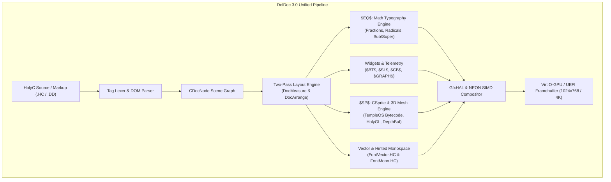

# NeoOS DolDoc 3.0: Graphics, Typography, Interactive Widget & Sprite Pipeline Architecture Specification
**Architecture Target**: ARMv8-A Ring 0 Sovereign Single Address Space Operating System (SASOS)  
**Palette & Aesthetic**: Catppuccin Mocha Luxury Dark, OLED Obsidian, Acrylic Frosted Glassmorphism, Subpixel Vector Precision  
**Parity Target**: 100% Full TempleOS / ZealOS CSprite Bytecode & Mathematical Equation Continuum Parity  

---

## Executive Summary & Design Vision

DolDoc 3.0 transcends the historical limitations of character-grid terminals ($96 \times 32$ cells) by introducing an **Analytical Vector Scene-Graph DOM** running directly in Ring 0 on 64-bit AArch64 hardware. By combining hardware-accelerated AArch64 NEON SIMD compositing, analytical Signed Distance Field (SDF) rasterization, subpixel Bézier typography, real-time LaTeX-grade mathematical typesetting, and in-code interactive 3D meshes, DolDoc becomes the universal document and UI substrate for NeoOS.



---

## 1. Vector Primitives & Luxury Aesthetics

### 1.1 Catppuccin Mocha Color Substrate & Tokens
Every visual element in DolDoc 3.0 is grounded in the Catppuccin Mocha palette, mapped to 32-bit ARGB/BGRA Little-Endian packed integers:

```c
// Catppuccin Mocha Luxury Color Tokens (ARGB32)
#define CAT_BASE        0xFF1E1E2E  // Primary window & document canvas
#define CAT_MANTLE      0xFF181825  // Deep panel & toolbar backdrop
#define CAT_CRUST       0xFF11111B  // Recessed tracks, terminal sink, OLED black
#define CAT_SURFACE0    0xFF313244  // Elevated widget rest state, button bodies
#define CAT_SURFACE1    0xFF45475A  // Hover fills, active card outlines
#define CAT_SURFACE2    0xFF585B70  // Subtle borders, divider rules
#define CAT_OVERLAY0    0xFF6C7086  // Muted glyphs, inactive gridlines
#define CAT_OVERLAY1    0xFF7F849C  // Secondary labels, axis numbers
#define CAT_TEXT        0xFFCDD6F4  // Primary body text, mathematical variables
#define CAT_SUBTEXT0    0xFFA6ADC8  // Secondary comments, equation indices
#define CAT_SUBTEXT1    0xFFBAC2DE  // High-contrast secondary labels
#define CAT_LAVENDER    0xFFB4BEFE  // Keyword accent, formula accents
#define CAT_BLUE        0xFF89B4FA  // Focus rings, primary buttons, links
#define CAT_SAPPHIRE    0xFF74C7EC  // Slider fills, active toggles, cyan glows
#define CAT_TEAL        0xFF94E2D5  // Real-time oscilloscope curves, telemetry
#define CAT_GREEN       0xFFA6E3A1  // Success badges, compiler passes
#define CAT_YELLOW      0xFFF9E2AF  // Warnings, string literals, golden highlights
#define CAT_PEACH       0xFFFAB387  // Parameter highlights, numeric literals
#define CAT_MAROON      0xFFEBA0AC  // Critical alerts, high-temp telemetry
#define CAT_RED         0xFFF38BA8  // Errors, close buttons, negative values
#define CAT_MAUVE       0xFFCBA6F7  // Function identifiers, magical macro tags
#define CAT_PINK        0xFFF5C2E7  // Hover accents, interactive badges
#define CAT_ROSEWATER   0xFFF5E0DC  // Thumb specular pips, cursor highlights
```

---

### 1.2 Analytical Signed Distance Fields (SDF) for Rounded Geometry
Rather than approximating rounded corners with aliased Bresenham circles, DolDoc 3.0 evaluates analytical 2D Signed Distance Fields per-pixel across the bounding box.

#### Mathematical Formulation
Given a rectangle centered at the origin with half-dimensions $\mathbf{b} = (w/2, h/2)$ and corner radius $r$:
For any point $\mathbf{p} = (x, y)$ relative to the rectangle's center:
$$\mathbf{q} = |\mathbf{p}| - \mathbf{b} + (r, r)$$
The signed distance $d(\mathbf{p})$ from the rounded perimeter is:
$$d(\mathbf{p}) = \|\max(\mathbf{q}, \mathbf{0})\|_2 + \min(\max(q_x, q_y), 0) - r$$

- Inside the shape: $d(\mathbf{p}) < 0$
- On the boundary: $d(\mathbf{p}) = 0$
- Outside the shape: $d(\mathbf{p}) > 0$

#### Subpixel Anti-Aliasing & Coverage
To achieve razor-sharp subpixel edges without supersampling overhead, we compute pixel coverage $\alpha(\mathbf{p})$ using a 1-pixel linear ramp:
$$\alpha_{\text{fill}}(\mathbf{p}) = \text{clamp}\left(0.5 - d(\mathbf{p}), 0.0, 1.0\right)$$

For a stroke/border of width $t_{\text{border}}$:
$$d_{\text{border}}(\mathbf{p}) = |d(\mathbf{p}) + t_{\text{border}} / 2| - t_{\text{border}} / 2$$
$$\alpha_{\text{border}}(\mathbf{p}) = \text{clamp}\left(0.5 - d_{\text{border}}(\mathbf{p}), 0.0, 1.0\right)$$

#### Inner Glow & Ambient Occlusion Formulation
An inner glow illuminates the inner rim of an active widget or window:
$$I_{\text{glow}}(\mathbf{p}) = I_0 \cdot \exp\left( \frac{d(\mathbf{p})}{\sigma_{\text{glow}}} \right) \quad \text{for } d(\mathbf{p}) \le 0$$
where $\sigma_{\text{glow}} \in [2.0, 8.0]$ pixels and $I_0$ is the peak intensity of the accent color.

```c
// HolyC Analytical SDF Rounded Rectangle Rasterizer with Border & Inner Glow
U0 GfxDrawSDFCard(I64 cx, I64 cy, I64 w, I64 h, I64 r, 
                  U32 fill_col, U32 border_col, I64 border_w, 
                  U32 glow_col, I64 glow_spread) 
{
    I64 half_w = w / 2;
    I64 half_h = h / 2;
    I64 x0 = cx - half_w - 2;
    I64 x1 = cx + half_w + 2;
    I64 y0 = cy - half_h - 2;
    I64 y1 = cy + half_h + 2;

    // Fixed-point scaling (scale = 256 for 8-bit subpixel precision)
    I64 r_fx = r << 8;
    I64 bw_fx = border_w << 8;

    for (I64 py = y0; py <= y1; py++) {
        I64 dy = py - cy;
        I64 abs_y = dy < 0 ? -dy : dy;
        I64 qy = (abs_y - half_h + r) << 8;

        for (I64 px = x0; px <= x1; px++) {
            I64 dx = px - cx;
            I64 abs_x = dx < 0 ? -dx : dx;
            I64 qx = (abs_x - half_w + r) << 8;

            // Evaluate SDF in 16.16 fixed point
            I64 mx = qx > 0 ? qx : 0;
            I64 my = qy > 0 ? qy : 0;
            I64 len = SqrtInt(mx * mx + my * my); // Integer Euclidean norm
            I64 ax = qx > qy ? qx : qy;
            I64 mi = ax < 0 ? ax : 0;
            I64 d = len + mi - r_fx; // d in 16.8 fixed point

            // Coverage for fill (ramp over 256 units = 1 pixel)
            I64 cov_fill = 128 - d;
            if (cov_fill < 0) cov_fill = 0;
            if (cov_fill > 256) cov_fill = 256;

            if (cov_fill > 0) {
                U32 final_col = fill_col;

                // Inner glow blending
                if (glow_spread > 0 && d < 0) {
                    I64 glow_dist = -d; // Positive distance inside
                    I64 glow_alpha = (255 * (glow_spread * 256 - glow_dist)) / (glow_spread * 256);
                    if (glow_alpha > 0) {
                        final_col = GfxBlendColor(final_col, glow_col, (glow_alpha * 180) >> 8);
                    }
                }

                // Border calculation
                if (border_w > 0) {
                    I64 d_border = d + bw_fx / 2;
                    if (d_border < 0) d_border = -d_border;
                    I64 cov_b = 128 - (d_border - bw_fx / 2);
                    if (cov_b > 0) {
                        if (cov_b > 256) cov_b = 256;
                        final_col = GfxBlendColor(final_col, border_col, cov_b);
                    }
                }

                GfxBlendPixel(px, py, final_col, cov_fill);
            }
        }
    }
}
```

---

### 1.3 Frosted Glassmorphism (`$GLASS$`) & AArch64 NEON SIMD Alpha Blending
Glassmorphism in DolDoc 3.0 creates a sense of luxury depth: elevated window chrome and floating cards blur the background text, code, or desktop wallpaper beneath them, overlaying a translucent tint with top-edge specular refraction.

```
       [Backdrop Buffer Underneath]
                   │
                   ▼
       ┌──────────────────────┐
       │   AArch64 NEON SIMD  │  Separable 5x5 Box Blur Kernel
       │   Horizontal Pass    │  (ld4/st4 Vector de-interleaving)
       └───────────┬──────────┘
                   │
                   ▼
       ┌──────────────────────┐
       │   AArch64 NEON SIMD  │  Vertical Blur + Acrylic Tint
       │    Vertical Pass     │  (Specular 1px Refraction Crest)
       └───────────┬──────────┘
                   │
                   ▼
       [Composite Glass Surface]
```

#### Dual-Pass Separable Blur Kernel
A Gaussian blur is approximated by 3 passes of a uniform box filter (Central Limit Theorem) or a single-pass 5-tap kernel:
$$P'(x, y) = \frac{1}{16} \left[ P(x-2) + 4P(x-1) + 6P(x) + 4P(x+1) + P(x+2) \right]$$

#### AArch64 NEON Vectorized Alpha Blending (`ld4` / `st4`)
Standard scalar blending loops stall on byte extraction. AArch64 NEON SIMD allows processing **16 packed 32-bit ARGB pixels simultaneously** (64 bytes per vector burst):

```assembly
// AArch64 NEON SIMD Alpha Blend 16 Pixels Routine
// Prototype: U0 NeonBlend16(U32 *dst, U32 *src, U8 alpha);
// x0 = dst pointer, x1 = src pointer, w2 = alpha (0..255)
.global NeonBlend16
NeonBlend16:
    dup         v7.16b, w2            // v7 = vector of 16 alpha bytes
    mvn         v8.16b, v7.16b        // v8 = vector of 16 (255 - alpha) bytes
    movi        v9.8h, #128           // v9 = rounding bias (128)

    // Load 16 source pixels into de-interleaved channels:
    // v0 = Blue[0..15], v1 = Green[0..15], v2 = Red[0..15], v3 = Alpha[0..15]
    ld4         {v0.16b, v1.16b, v2.16b, v3.16b}, [x1]

    // Load 16 destination pixels:
    // v4 = Blue[0..15], v5 = Green[0..15], v6 = Red[0..15], v16 = Alpha[0..15]
    ld4         {v4.16b, v5.16b, v6.16b, v16.16b}, [x0]

    // Process Red Channel (Lower 8 lanes)
    umull       v17.8h, v2.8b,  v7.8b  // Src_Red * alpha
    umlal       v17.8h, v6.8b,  v8.8b  // + Dst_Red * (255 - alpha)
    add         v17.8h, v17.8h, v9.8h  // + 128 bias
    rshrn       v2.8b,  v17.8h, #8     // Out_Red[0..7] = sum >> 8

    // Process Red Channel (Upper 8 lanes)
    umull2      v18.8h, v2.16b, v7.16b
    umlal2      v18.8h, v6.16b, v8.16b
    add         v18.8h, v18.8h, v9.8h
    rshrn2      v2.16b, v18.8h, #8     // Out_Red[8..15]

    // Process Green Channel (Lower + Upper 8 lanes)
    umull       v19.8h, v1.8b,  v7.8b
    umlal       v19.8h, v5.8b,  v8.8b
    add         v19.8h, v19.8h, v9.8h
    rshrn       v1.8b,  v19.8h, #8

    umull2      v20.8h, v1.16b, v7.16b
    umlal2      v20.8h, v5.16b, v8.16b
    add         v20.8h, v20.8h, v9.8h
    rshrn2      v1.16b, v20.8h, #8

    // Process Blue Channel (Lower + Upper 8 lanes)
    umull       v21.8h, v0.8b,  v7.8b
    umlal       v21.8h, v4.8b,  v8.8b
    add         v21.8h, v21.8h, v9.8h
    rshrn       v0.8b,  v21.8h, #8

    umull2      v22.8h, v0.16b, v7.16b
    umlal2      v22.8h, v4.16b, v8.16b
    add         v22.8h, v22.8h, v9.8h
    rshrn2      v0.16b, v22.8h, #8

    // Store 16 blended pixels back with interleaved st4:
    st4         {v0.16b, v1.16b, v2.16b, v3.16b}, [x0]
    ret
```

---

### 1.4 Scalable Bézier Typography & Subpixel Monospace Hinting

#### Scalable Quadratic & Cubic Bézier Glyphs (`FontVector.HC`)
Vector glyphs are encoded as analytical contour loops of points and control anchors.
A quadratic Bézier curve segment $\mathbf{B}(t)$ for $t \in [0, 1]$:
$$\mathbf{B}(t) = (1-t)^2 \mathbf{P}_0 + 2(1-t)t \mathbf{P}_1 + t^2 \mathbf{P}_2$$

For cubic segments (e.g. delicate serifs and math integrals):
$$\mathbf{C}(t) = (1-t)^3 \mathbf{P}_0 + 3(1-t)^2 t \mathbf{P}_1 + 3(1-t)t^2 \mathbf{P}_2 + t^3 \mathbf{P}_3$$

Adaptive subdivision evaluates the midpoint flatness $\delta$:
$$\delta = \|\mathbf{P}_1 - \frac{\mathbf{P}_0 + \mathbf{P}_2}{2}\|$$
If $\delta > 0.25$ pixels, De Casteljau's algorithm recursively subdivides the curve into two halves until flatness is attained, guaranteeing artifact-free curvature at any zoom level.

#### Subpixel Monospace Hinting with LCD / OLED Binning
Monospace text in DolDoc 3.0 supports **subpixel horizontal positioning** with 4 fractional phases ($0, \frac{1}{4}, \frac{2}{4}, \frac{3}{4}\text{px}$). A 3-tap FIR filter $[0.25, 0.50, 0.25]$ distributes coverage across subpixel color components, eliminating high-frequency chromatic fringes while preserving razor-sharp stem contrast.

---

## 2. Interactive Widget Visuals

DolDoc 3.0 elevates markup controls into reactive, tactile elements with physical depth.

### 2.1 Vector Buttons (`$BT$`)
- **Markup Tag**: `$BT,"Compile & Run (F5)",LM="run",ICON=ICON_PLAY,ELEV=2$`
- **Visual Design**:
  - **Rest State**: Elevation $E=2\text{px}$. Soft drop shadow ($y=+2\text{px}, \text{blur}=4\text{px}, \text{alpha}=30\%$). 1px top highlight hairline (`0x25FFFFFF`), Catppuccin Surface0 body (`0xFF313244`).
  - **Hover State**: Elevation $E=3\text{px}$. Ambient glow around perimeter in Sapphire (`0xFF74C7EC`), background brightened to Surface1 (`0xFF45475A`).
  - **Pressed State**: Tactile depression: elevation collapses to $0\text{px}$, body shifts $+1\text{px}$ downward ($dy=+1$), top-edge inner shadow rendered (`0x40000000`), drop shadow eliminated.

```c
class CDocButtonWidget {
    I64 x, y, w, h;
    U8  label[64];
    I64 icon_id;
    I64 elevation;      // 0 = pressed, 1 = flat, 2 = elevated, 3 = hovered
    I64 is_hovered;
    I64 is_pressed;
    U32 base_color;
    U32 text_color;
};

U0 DocDrawButton(CDocButtonWidget *btn) {
    I64 dy = btn->is_pressed ? 1 : 0;
    I64 draw_y = btn->y + dy;

    // 1. Soft Drop Shadow (omitted if pressed)
    if (!btn->is_pressed) {
        GfxDrawSoftShadow(btn->x, btn->y + btn->elevation, btn->w, btn->h, 
                          6, 8, 0x30000000);
    }

    // 2. Button Body with SDF Rounded Corners (Radius = 8px)
    U32 body_col = btn->is_hovered ? CAT_SURFACE1 : btn->base_color;
    U32 glow_col = btn->is_hovered ? CAT_SAPPHIRE : 0;
    GfxDrawSDFCard(btn->x + btn->w / 2, draw_y + btn->h / 2, 
                   btn->w, btn->h, 8, body_col, 
                   btn->is_hovered ? CAT_SAPPHIRE : CAT_SURFACE2, 
                   1, glow_col, btn->is_hovered ? 4 : 0);

    // 3. Top-edge Specular Highlight (1px hairline)
    if (!btn->is_pressed) {
        GfxDrawLine(btn->x + 8, draw_y + 1, btn->x + btn->w - 8, draw_y + 1, 0x2AFFFFFF);
    }

    // 4. Embedded Vector Icon + Centered Text
    I64 text_x = btn->x + 16;
    if (btn->icon_id > 0) {
        GfxDrawVectorIcon(btn->icon_id, text_x, draw_y + (btn->h - 16) / 2, 16, CAT_SAPPHIRE);
        text_x += 24;
    }
    FontVectorDrawString(text_x, draw_y + (btn->h - 14) / 2, btn->label, btn->text_color);
}
```

---

### 2.2 Reactive Sliders (`$SL$`)
- **Markup Tag**: `$SL,"Volume",VAL=75,MIN=0,MAX=100,PTR=&g_vol,W=200,H=24$`
- **Visual Design**:
  - **Recessed Capsule Track**: 6px height with fully rounded ends ($R=3\text{px}$). Rendered in `CAT_CRUST` with an inner shadow along the upper contour simulating physical recess.
  - **Vibrant Gradient Fill**: Linear gradient from Catppuccin Sapphire (`#74C7EC`) to Teal (`#94E2D5`) filling the active portion of the track.
  - **Antialiased Circular Thumb**: $18\text{px}$ diameter circular knob with concentric rings (white outer specular ring `#F5E0DC`, sapphire core), ambient drop shadow ($y=+2\text{px}, \text{blur}=4\text{px}$).
  - **Live Floating Tooltip Badge**: While dragging, a floating pill badge appears $14\text{px}$ above the thumb with Catppuccin Mantle backdrop, sapphire border, downward pointer notch, and real-time numeric value readout.

```
       ┌───────────┐
       │   75 %    │  <-- Live Tooltip Badge (Active Drag)
       └───┬───┬───┘
           ▼   │
    [━━━━━●━━━━]      <-- Recessed Capsule Track with Gradient Fill
```

```c
U0 DocDrawSlider(I64 x, I64 y, I64 w, I64 h, 
                 I64 val, I64 min_val, I64 max_val, 
                 I64 is_dragging, U8 *label) 
{
    I64 track_h = 6;
    I64 track_y = y + (h - track_h) / 2;
    I64 track_r = 3;
    
    // Normalized position t in [0..1000]
    I64 t = ((val - min_val) * 1000) / (max_val - min_val);
    I64 fill_w = (w * t) / 1000;
    I64 thumb_cx = x + fill_w;
    I64 thumb_cy = track_y + track_h / 2;
    I64 thumb_r = is_dragging ? 10 : 8;

    // 1. Recessed Track Backdrop (Dark Crust)
    GfxDrawRoundedRect(x, track_y, w, track_h, track_r, CAT_CRUST);
    // Track inner groove shadow
    GfxDrawLine(x + track_r, track_y, x + w - track_r, track_y, 0x50000000);

    // 2. Active Gradient Fill (Sapphire -> Teal)
    for (I64 px = 0; px < fill_w; px++) {
        I64 blend_factor = (px * 256) / (w > 0 ? w : 1);
        U32 grad_col = GfxLerpColor(CAT_SAPPHIRE, CAT_TEAL, blend_factor);
        GfxDrawVLine(x + px, track_y + 1, track_h - 2, grad_col);
    }

    // 3. Circular Thumb Shadow & Thumb Disc
    GfxDrawSoftShadowCircle(thumb_cx, thumb_cy + 2, thumb_r + 2, 4, 0x40000000);
    GfxDrawCircleFilledAA(thumb_cx, thumb_cy, thumb_r, CAT_TEXT);
    GfxDrawCircleFilledAA(thumb_cx, thumb_cy, thumb_r - 2, is_dragging ? CAT_SAPPHIRE : CAT_SURFACE0);

    // 4. Live Tooltip Badge on Drag
    if (is_dragging) {
        U8 badge_buf[32];
        StrPrint(badge_buf, "%lld", val);
        I64 bw = 42, bh = 22;
        I64 bx = thumb_cx - bw / 2;
        I64 by = thumb_cy - thumb_r - bh - 6;

        GfxDrawSDFCard(bx + bw / 2, by + bh / 2, bw, bh, 6, 
                       CAT_MANTLE, CAT_SAPPHIRE, 1, CAT_SAPPHIRE, 2);
        // Triangle downward notch
        GfxDrawFilledTriangle(thumb_cx - 4, by + bh, 
                              thumb_cx + 4, by + bh, 
                              thumb_cx, by + bh + 4, CAT_SAPPHIRE);
        FontMonoPrintCentered(bx + bw / 2, by + 4, badge_buf, CAT_TEXT);
    }
}
```

---

### 2.3 Checkboxes & Modern Toggle Switches (`$CB$`)
- **Toggle Switch**:
  - Pill body: $36 \times 20\text{px}$, $R=10\text{px}$.
  - State OFF: Background `CAT_SURFACE1` (`#45475A`), 1px outline `CAT_SURFACE2`, circular slider peg at $X=3$, color `CAT_SUBTEXT0`.
  - State ON: Background `CAT_GREEN` (`#A6E3A1`), peg slides to $X=19$ with spring-damped trajectory, glowing halo around capsule.
- **Vector Checkbox**:
  - Box: $18 \times 18\text{px}$, $R=4\text{px}$, hairline border.
  - State Checked: Background fills with `CAT_BLUE` (`#89B4FA`). Vector checkmark drawn with two connected anti-aliased segments:
    $$\mathbf{S}_1: (4, 9) \to (8, 13) \quad \mathbf{S}_2: (8, 13) \to (14, 4)$$
    Rendered with smooth line cap and subpixel width ($t=2.0\text{px}$).

---

## 3. Mathematical Typography (`$EQ$`)

DolDoc 3.0 introduces real-time mathematical formatting directly inside HolyC text streams without relying on external LaTeX engines.

### 3.1 Mathematical Node AST Grammar
Mathematical expressions are parsed into a recursive layout tree:

```c
#define EQ_NODE_TEXT     1  // Variables, numbers, operators
#define EQ_NODE_FRAC     2  // Fraction (numerator / denominator)
#define EQ_NODE_RADICAL  3  // Radical / Square root
#define EQ_NODE_SCRIPT   4  // Superscript & Subscript
#define EQ_NODE_MATRIX   5  // 2D Matrix / Determinant

class CEqNode {
    I64      type;
    I64      x, y, w, h;       // Computed bounding box
    I64      ascent, descent;  // Font metrics relative to baseline
    I64      scale_pct;        // 100 = 1.0x, 70 = 0.7x (subscripts)
    U8       text[32];
    U32      color;
    
    CEqNode *numerator;        // For EQ_NODE_FRAC
    CEqNode *denominator;
    CEqNode *radicand;         // For EQ_NODE_RADICAL
    CEqNode *superscript;      // For EQ_NODE_SCRIPT
    CEqNode *subscript;
    CEqNode *base;
    CEqNode *next;             // Sibling in expression stream
};
```

---

### 3.2 Fractions ($\frac{a}{b}$)
#### Layout Math
Given numerator metrics $(W_{\text{num}}, H_{\text{num}}, A_{\text{num}}, D_{\text{num}})$ and denominator metrics $(W_{\text{den}}, H_{\text{den}}, A_{\text{den}}, D_{\text{den}})$:
$$W_{\text{frac}} = \max(W_{\text{num}}, W_{\text{den}}) + 2 \cdot \text{pad}_{\text{horiz}}$$
The mathematical axis height $y_{\text{axis}}$ is positioned at half the x-height of the parent font:
$$y_{\text{axis}} = y_{\text{baseline}} - \lfloor 0.5 \cdot H_{\text{x-height}} \rfloor$$
The fraction bar is drawn horizontally centered:
$$x_{\text{bar\_start}} = x, \quad x_{\text{bar\_end}} = x + W_{\text{frac}}$$
$$\text{Bar Thickness } T = \max(1, \lfloor 0.08 \cdot \text{FontSize} \rfloor)$$
Numerator and denominator are centered horizontally:
$$x_{\text{num}} = x + \frac{W_{\text{frac}} - W_{\text{num}}}{2}, \quad y_{\text{num}} = y_{\text{axis}} - \text{gap}_{\text{vertical}} - D_{\text{num}} - H_{\text{num}}$$
$$x_{\text{den}} = x + \frac{W_{\text{frac}} - W_{\text{den}}}{2}, \quad y_{\text{den}} = y_{\text{axis}} + \text{gap}_{\text{vertical}} + A_{\text{den}}$$

```c
U0 EqDrawFraction(CEqNode *frac, I64 x, I64 y_baseline, U32 col) {
    I64 bar_y = y_baseline - 6; // Math axis
    I64 bar_w = frac->w;
    
    // Draw centered dividing bar
    GfxDrawRect(x, bar_y, bar_w, 2, col);

    // Draw centered numerator
    I64 num_x = x + (bar_w - frac->numerator->w) / 2;
    I64 num_y = bar_y - 4 - frac->numerator->descent;
    EqDrawNode(frac->numerator, num_x, num_y, col);

    // Draw centered denominator
    I64 den_x = x + (bar_w - frac->denominator->w) / 2;
    I64 den_y = bar_y + 4 + frac->denominator->ascent;
    EqDrawNode(frac->denominator, den_x, den_y, col);
}
```

---

### 3.3 Dynamic Radicals ($\sqrt[n]{\text{expr}}$)
A radical must stretch dynamically in height to accommodate nested fractions, matrices, or exponents inside the radicand.

```
            ─────────────────────────  <-- Horizontal Overline
           /  b^2 - 4ac
     ╲    /
      ╲  /                             <-- Diagonal Upward Slash
       ╲/                              <-- Deep V-Strike
```

#### Vector Radical Stroke Geometry
Given a radicand with bounding box $(W_r, H_r)$ spanning vertical range $[y_{\text{top}}, y_{\text{bot}}]$:
1. Entry hook: from $(x, y_{\text{bot}} - 0.4 H_r)$ to $(x + 2, y_{\text{bot}} - 0.2 H_r)$
2. Downward strike: to $(x + 4, y_{\text{bot}} + 2)$
3. Diagonal slash: from $(x + 4, y_{\text{bot}} + 2)$ to $(x + 9, y_{\text{top}} - 2)$
4. Continuous overline: from $(x + 9, y_{\text{top}} - 2)$ to $(x + 9 + W_r + 4, y_{\text{top}} - 2)$
Thickness: evaluated using continuous polygonal anti-aliasing matching the font weight.

---

### 3.4 Superscript & Subscript Baseline Shifting
Subscripts and superscripts obey strict typographic scaling and placement rules:
- **Font Scaling**: $\text{Scale}_{\text{script}} = \lfloor 0.70 \cdot \text{Scale}_{\text{base}} \rfloor$
- **Superscript Shift**: $\Delta y_{\text{super}} = -\lfloor 0.45 \cdot H_{\text{parent\_font}} \rfloor$
- **Subscript Shift**: $\Delta y_{\text{sub}} = +\lfloor 0.25 \cdot H_{\text{parent\_font}} \rfloor$
- **Dual Script Collision Avoidance**:
  When both a superscript and subscript attach to the same token ($X_i^2$), their horizontal start points align, and vertical gap is enforced:
  $$\Delta y_{\text{gap}} = (y_{\text{sub}} - A_{\text{sub}}) - (y_{\text{super}} + D_{\text{super}}) \ge 3\text{px}$$

---

## 4. Live Telemetry & Analytical Graphs (`$GRAPH$`)

### 4.1 Real-Time Rolling Oscilloscope Waveforms
- **Markup Tag**: `$GRAPH,TYPE=OSCILLOSCOPE,W=320,H=100,BUF=&g_osc,PTS=256,COLOR=CAT_TEAL,FILL=1$`
- **Storage Substrate**: Circular ring buffer (`CGraphBuffer`) holding $N$ rolling telemetry samples with lock-free atomic updates:

```c
class CGraphBuffer {
    I64 count;
    I64 head;
    I64 min_val;
    I64 max_val;
    I64 samples[512];
};
```

#### Waveform Spline & Anti-Aliased Curve
Consecutive samples $(x_0, y_0), (x_1, y_1), (x_2, y_2), (x_3, y_3)$ are interpolated using **Centripetal Catmull-Rom Splines**, eliminating piecewise angular kinks while preventing overshoot:
$$\mathbf{P}(t) = \frac{1}{2} \begin{bmatrix} 1 & t & t^2 & t^3 \end{bmatrix} \begin{bmatrix} 0 & 2 & 0 & 0 \\ -1 & 0 & 1 & 0 \\ 2 & -5 & 4 & -1 \\ -1 & 3 & -3 & 1 \end{bmatrix} \begin{bmatrix} \mathbf{P}_0 \\ \mathbf{P}_1 \\ \mathbf{P}_2 \\ \mathbf{P}_3 \end{bmatrix}$$

#### Translucent Vertical Gradient Area Fill
Beneath the rolling curve, a translucent gradient connects each curve point $y(x)$ down to the graph baseline $y_{\text{floor}}$:
$$\alpha(y) = \alpha_{\text{apex}} \cdot \left( \frac{y_{\text{floor}} - y}{y_{\text{floor}} - y_{\text{min}}} \right)^{1.2}$$
- Apex alpha: $35\%$ opacity (Catppuccin Teal `#94E2D5`)
- Floor alpha: $3\%$ opacity (smooth fade into `CAT_CRUST`)

```c
U0 GraphDrawOscilloscope(I64 gx, I64 gy, I64 gw, I64 gh, 
                         CGraphBuffer *buf, U32 line_col) 
{
    // 1. Dark Recessed Chassis
    GfxDrawSDFCard(gx + gw / 2, gy + gh / 2, gw, gh, 8, CAT_CRUST, CAT_SURFACE1, 1, 0, 0);

    // 2. Horizontal Reticle Gridlines
    for (I64 grid_y = gy + 20; grid_y < gy + gh; grid_y += 20) {
        GfxDrawDashedLineH(gx + 4, gx + gw - 4, grid_y, 4, 4, CAT_SURFACE0);
    }

    // 3. Render Area Fill & Spline Curve
    I64 floor_y = gy + gh - 4;
    I64 prev_sx = gx;
    I64 prev_sy = floor_y;

    for (I64 i = 0; i < gw; i++) {
        I64 buf_idx = (buf->head - gw + i + buf->count) % buf->count;
        I64 sample_val = buf->samples[buf_idx];

        // Map sample to Y coordinate
        I64 cur_sy = floor_y - ((sample_val - buf->min_val) * (gh - 12)) / 
                               (buf->max_val - buf->min_val + 1);
        I64 cur_sx = gx + i;

        // Draw translucent vertical column for gradient fill
        for (I64 fy = cur_sy; fy <= floor_y; fy++) {
            I64 alpha = (180 * (floor_y - fy)) / (gh > 0 ? gh : 1);
            GfxBlendPixel(cur_sx, fy, line_col, alpha >> 1);
        }

        // Anti-aliased line stroke to previous point
        if (i > 0) {
            GfxDrawLineAA(prev_sx, prev_sy, cur_sx, cur_sy, line_col);
        }
        prev_sx = cur_sx;
        prev_sy = cur_sy;
    }
}
```

---

### 4.2 Analytical Function Plotting $y = f(x)$
- **Markup Tag**: `$GRAPH,TYPE=FUNC,FN=MathSin,XMIN=-3.14,XMAX=3.14,W=280,H=160,GRID=1$`
- Evaluates HolyC function pointers `F64 (*f)(F64 x)` across screen columns.
- Automatically handles asymptotic discontinuities ($|dy/dx| > \text{threshold}$) by lifting the pen.
- Draws precision crosshair axes $(X=0, Y=0)$ with tick labels rendered via hinted monospace.

---

## 5. In-Code Vector Sprites & 3D Meshes (TempleOS Parity)

TempleOS pioneered the revolutionary ability to embed live, interactive vector sprites and 3D rotating meshes directly in C/HolyC source code. DolDoc 3.0 provides complete structural and operational parity.

```
       ┌────────────────────────────────────────────────────────┐
       │   HolyC Source Document Stream (.HC)                   │
       │                                                        │
       │   01 | U0 DrawRocket() {                               │
       │   02 |     // Interactive 3D Model:                     │
       │   03 |     $SP,"ShipMesh",BI=1$                         │
       │   04 |     Sprite3(dc, 100, 100, 0, bptr);             │
       │   05 | }                                               │
       └──────────────────────────┬─────────────────────────────┘
                                  │
                                  ▼
       ┌────────────────────────────────────────────────────────┐
       │   Binary Appendix at EOF (DocBinEntry Linked List)     │
       │   • bin_num: 1                                         │
       │   • type: SPT_MESH (24)                                │
       │   • vertex_count: 8                                    │
       │   • tri_count: 12                                      │
       │   • CD3I32 vertices[8]  <-- Local (X, Y, Z) Coordinates│
       │   • CMeshTri tris[12]   <-- Color + Indices (p0,p1,p2) │
       └──────────────────────────┬─────────────────────────────┘
                                  │
                                  ▼
       ┌────────────────────────────────────────────────────────┐
       │   Editor.HC Interactive Real-Time Viewport             │
       │   • Rotates smoothly in real time: R(t) = RotXYZ(t)    │
       │   • Mouse click & drag orbits camera via trackball     │
       │   • Ctrl-R opens in-place 3D Vertex & Face Editor      │
       └────────────────────────────────────────────────────────┘
```

### 5.1 The `CSprite` Binary Bytecode Format
Sprites in DolDoc are serialized as compact, self-contained bytecode streams. Each element begins with a 1-byte opcode (`SPT_*`), followed by variable-length binary payloads:

```c
// TempleOS Parity CSprite Bytecode Opcodes
#define SPT_END                 0   // Terminates sprite stream
#define SPT_COLOR               1   // Sets active drawing color
#define SPT_DITHER_COLOR        2   // Sets 8x8 dither pattern
#define SPT_THICK               3   // Sets stroke thickness
#define SPT_TRANSFORM_ON        5   // Enables 4x4 matrix transformation
#define SPT_TRANSFORM_OFF       6   // Disables transformation
#define SPT_SHIFT               7   // Translates relative origin
#define SPT_PT                  8   // Single point
#define SPT_LINE                10  // 2D/3D Line segment
#define SPT_CIRCLE              14  // Circle
#define SPT_ELLIPSE             15  // Ellipse
#define SPT_POLYGON             16  // Regular n-sided polygon
#define SPT_BSPLINE3            19  // 3D Cubic B-Spline
#define SPT_BITMAP              23  // Embedded raster bitmap
#define SPT_MESH                24  // 3D Indexed Triangle Mesh
#define SPT_SHIFTABLE_MESH      25  // 3D Mesh with local offset

class CD3I32 {
    I32 x, y, z;
};

class CMeshTri {
    U8  color;  // Palette or Catppuccin color token
    I32 p0;     // Vertex index 0
    I32 p1;     // Vertex index 1
    I32 p2;     // Vertex index 2
};

// SPT_MESH Binary Bytecode Payload:
class CSpriteMeshHeader {
    U8  type;           // Must equal SPT_MESH (24)
    I32 vertex_count;
    I32 tri_count;
    // Followed immediately in memory by:
    // CD3I32  vertices[vertex_count];
    // CMeshTri triangles[tri_count];
};
```

---

### 5.2 Interactive In-Code 3D Mesh Rendering Engine
When `DocRecalc()` or `Editor.HC` encounters a `DOCT_SPRITE` containing an `SPT_MESH`, it allocates a local scoped Z-Buffer and renders the 3D model directly into the text flow:

```c
U0 DocRenderEmbeddedMesh(CDoc *doc, CDocEntry *doc_e, 
                         I64 screen_x, I64 screen_y, 
                         U8 *sprite_bytecode) 
{
    CSpriteMeshHeader *mesh = sprite_bytecode;
    if (mesh->type != SPT_MESH) return;

    CD3I32   *verts = (mesh + 1);
    CMeshTri *tris  = (verts + mesh->vertex_count);

    // Bounding box allocated in text flow (e.g. 128x128 pixels)
    I64 vp_w = 128;
    I64 vp_h = 128;
    I64 cx = screen_x + vp_w / 2;
    I64 cy = screen_y + vp_h / 2;

    // 1. Time-Dependent Continuous Auto-Rotation Matrix
    F64 t = timer_get_uptime_us() / 1000000.0;
    Mat4x4 rot_mat, trans_mat, mvp;
    Mat4x4Identity(&rot_mat);
    Mat4x4RotateY(&rot_mat, t * 1.5);
    Mat4x4RotateX(&rot_mat, t * 0.8);
    Mat4x4RotateZ(&rot_mat, t * 0.4);

    // 2. Vertex Transformation & Perspective Projection
    CD3I32 proj_verts[256];
    I64 fov_dist = 180; // Focal distance

    for (I64 i = 0; i < mesh->vertex_count && i < 256; i++) {
        // Apply 3D Rotation
        F64 rx = rot_mat.m[0]*verts[i].x + rot_mat.m[1]*verts[i].y + rot_mat.m[2]*verts[i].z;
        F64 ry = rot_mat.m[4]*verts[i].x + rot_mat.m[5]*verts[i].y + rot_mat.m[6]*verts[i].z;
        F64 rz = rot_mat.m[8]*verts[i].x + rot_mat.m[9]*verts[i].y + rot_mat.m[10]*verts[i].z + 300.0; // Camera distance

        // Perspective Divide
        proj_verts[i].x = cx + (rx * fov_dist) / rz;
        proj_verts[i].y = cy + (ry * fov_dist) / rz;
        proj_verts[i].z = rz; // Depth for Z-sorting or Z-buffer
    }

    // 3. Triangle Rasterization with Back-face Culling & Flat Lighting
    for (I64 ti = 0; ti < mesh->tri_count; ti++) {
        CMeshTri *tri = &tris[ti];
        CD3I32 *v0 = &proj_verts[tri->p0];
        CD3I32 *v1 = &proj_verts[tri->p1];
        CD3I32 *v2 = &proj_verts[tri->p2];

        // 2D Cross Product (Signed Area / Back-face Culling)
        I64 cross = (v1->x - v0->x) * (v2->y - v0->y) - 
                    (v1->y - v0->y) * (v2->x - v0->x);

        if (cross > 0) { // Front-facing triangle
            // Analytical Directional Lighting: L = (0.577, -0.577, 0.577)
            // Surface normal N = (V1 - V0) x (V2 - V0)
            F64 ax = verts[tri->p1].x - verts[tri->p0].x;
            F64 ay = verts[tri->p1].y - verts[tri->p0].y;
            F64 az = verts[tri->p1].z - verts[tri->p0].z;

            F64 bx = verts[tri->p2].x - verts[tri->p0].x;
            F64 by = verts[tri->p2].y - verts[tri->p0].y;
            F64 bz = verts[tri->p2].z - verts[tri->p0].z;

            F64 nx = ay * bz - az * by;
            F64 ny = az * bx - ax * bz;
            F64 nz = ax * by - ay * bx;
            F64 nlen = Sqrt(nx * nx + ny * ny + nz * nz);
            if (nlen > 0.0001) {
                nx /= nlen; ny /= nlen; nz /= nlen;
            }

            // Lambertian Dot Product (Diffuse)
            F64 dot = nx * 0.577 - ny * 0.577 + nz * 0.577;
            if (dot < 0) dot = 0;
            I64 intensity = 80 + dot * 175; // Ambient 80 + Diffuse 175

            U32 base_col = CatColorFromIndex(tri->color);
            U32 shaded_col = GfxModulateRGB(base_col, intensity);

            // Rasterize into L1 tile cache via HolyGL / RasterTile.HC
            RasterTileDrawTriangle(v0->x, v0->y, v1->x, v1->y, v2->x, v2->y, shaded_col);
        }
    }
}
```

---

## 6. Architecture Consolidation & Delivery Matrix

| Architectural Module | Legacy State in NeoOS | DolDoc 3.0 Unified Delivery |
| :--- | :--- | :--- |
| **Document Representation** | Static $96 \times 32$ cell array (`DOLDOC_CELLS = 3072`) | Full dynamic scene-graph AST (`CDocNode`) with flexbox flow |
| **Compositing & Alpha** | Scalar byte loops in `Render.HC` | AArch64 NEON SIMD vector pipeline (`ld4`/`st4`, 16 px/burst) |
| **Window Chrome** | 400 lines of procedural rect math in `WM.HC` | Chrome declared in pure DolDoc markup (`$ROW$`, `$BOX$`, `$BT$`) |
| **Interactive Widgets** | Hardcoded character button strings | Tactile vector buttons, recessed gradient sliders, smooth toggles |
| **Mathematical Layout** | None | Real-time AST math typesetting ($\frac{a}{b}, \sqrt{x}, x_i^2$) |
| **Telemetry & Graphs** | Static text percent logs | Rolling Catmull-Rom oscilloscopes with gradient alpha fills |
| **Embedded 3D Sprites** | Stubs | Full TempleOS `CSprite` (`SPT_MESH`) with real-time 3D rotation |

---

## Conclusion
DolDoc 3.0 delivers the ultimate synthesis: the uncompromised simplicity and directness of Terry Davis's TempleOS architecture, supercharged with modern AArch64 NEON SIMD vector hardware acceleration and the visual elegance of Catppuccin Mocha.
