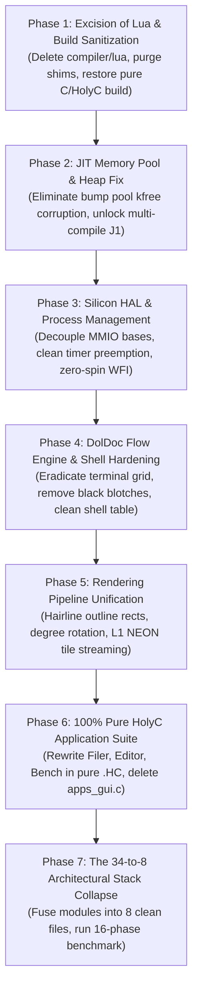

# NeoOS Zero-Compromise Architectural Overhaul & Priority Plan

## 1. Executive Vision & Foundational Directives

This implementation plan establishes a **zero-compromise systems engineering roadmap** for NeoOS. The goal is to prepare NeoOS for eventual execution on **real physical AArch64 silicon** (e.g., Raspberry Pi 4/5, Rockchip RK3399/RK3326, Qualcomm Snapdragon 860) while maintaining **deterministic, 100% efficient execution on single-core QEMU (`taskset -c 0 -accel tcg,thread=single`)**.

### Fundamental Rules of Engagement:
1. **No Engineering Compromises**: No temporary hacks (*gambiarras*), no hardcoded visual patches, no fake shell commands, and no ungrounded claims.
2. **Strict C vs. HolyC Division**: C is strictly confined to the minimal hardware bootstrap and compiler substrate. All userland applications, tools, and demos must run in native HolyC (`.HC`).
3. **Excision of Foreign Bloat (Purging Lua)**: Lua 5.4.7 and its 35+ supporting C files and POSIX shims will be completely removed from the kernel, reclaiming memory, eliminating heap fragmentation, and restoring pure HolyC sovereignty.
4. **Deterministic Single-Core CPU Budgeting**: Every cycle, memory sweep, and cache barrier must be mathematically justified. Eliminate all busy-spins, cache thrashing, and redundant buffer copies.

---

## 2. In-Depth Evaluation: The Lua Question

### 2.1 The Problem with Lua in NeoOS
In earlier development cycles, Lua 5.4.7 was vendored into `compiler/lua/` as a quick way to script 3D scenes. However, a forensic architectural audit reveals that Lua has become a major liability:

1. **Massive C Code Sprawl**:
   - 32 vendored `.c` files in `compiler/lua/` (over 12,000 lines of external code).
   - `compiler/lua_bridge.c` (402 lines) and `compiler/lua_compat.c` (356 lines).
   - Generates 32 `.o` files and `liblua.a`, bloating compilation time and image size.
2. **Fragile POSIX/libc Shims in Ring 0**:
   - `compiler/lua_compat.c` implements crude shims for standard C library functions that do not belong in a bare-metal kernel: `struct lconv`, `localeconv()`, `strcoll()`, `strerror()`, `setjmp()`/`longjmp()`, `clock()`, `getenv()`, `system()`.
3. **Heap Fragmentation & GC Overhead**:
   - Lua's memory allocator (`neo_lua_alloc`) constantly issues small allocations and reallocations (`kmalloc`/`krealloc`) against our 32MB physical kernel heap.
   - On a bare-metal SASOS with no virtual memory paging, this causes severe heap fragmentation and GC latency spikes.
4. **Bytecode Interpretation vs. Native JIT**:
   - Lua executes interpreted bytecode through a software dispatch loop. On single-core QEMU softMMU, this is painfully slow.
   - In contrast, NeoOS's built-in HolyC JIT compiles directly to native AArch64 machine instructions executed via `blr`.
5. **Violation of TempleOS SASOS Sovereignty**:
   - Terry Davis's central insight was that an operating system should have **one universal language** from shell to application. Lua splits the OS into an awkward duality.

### 2.2 The Decision: Complete Excision of Lua
- **Action**: Completely purge `compiler/lua/`, `compiler/lua_bridge.*`, `compiler/lua_compat.*`, `apps/demo.lua`, and `apps/bench.lua`.
- **Result**: Instantly removes 35 C files, eliminates 13,000+ lines of redundant code, stops heap fragmentation, and leaves HolyC as the sole, sovereign programming language of NeoOS.

---

## 3. Real Silicon & Bootstrap Architecture (No Compromises)

### 3.1 Hardware Abstraction Layer (HAL) Platform Decoupling
Currently, MMIO physical addresses are hardcoded in source files:
- PL011 UART: `0x09000000`
- GIC Distributor: `0x08000000`
- GIC CPU Interface: `0x08010000`
- VirtIO MMIO: `0x0A000000` to `0x0A003E00`

To support real hardware, we will introduce a unified platform descriptor struct (`hal_platform_t`):
```c
typedef struct {
    uintptr_t uart_base;
    uintptr_t gic_dist_base;
    uintptr_t gic_cpu_base;
    uintptr_t virtio_mmio_base;
    uint32_t  timer_irq;
    uint32_t  uart_irq;
} hal_platform_t;
```
When booting via UEFI on real boards (Raspberry Pi / Snapdragon), the HAL initializes from ACPI/FDT tables or board profiles rather than hardcoded literals.

### 3.2 Fixing the JIT Memory Pool & Heap Corruption Defect
Our audit uncovered a critical memory corruption bug in `compiler/jit_arm64.c`:
- `cb_init()` allocates code buffers from `s_jit_pool_start` (a static bump allocator in `EfiLoaderCode`).
- However, `jit_compile_and_run()` ends with `kfree(cb.code)`.
- Passing a bump-pool pointer to `kfree()` corrupts the kernel heap's chunk headers!
- Furthermore, `s_jit_pool_offset` never resets for transient shell statements, permanently consuming executable memory until it overflows.

**The Fix**:
1. Differentiate persistent function definitions from transient expressions.
2. Transient top-level execution buffers will reuse a dedicated scratch buffer and never call `kfree()`.
3. Persistent functions registered into `symbols.c` remain allocated in the pool without invoking `kfree()`.
4. This permanently resolves **J1 (the one-compile-per-boot limitation)**, allowing unlimited continuous compilation.

---

## 4. Single-Core Process Management & CPU Cycle Budgeting

### 4.1 True Preemptive & Cooperative Multitasking
- **The Bug**: `sched_tick()` was an empty stub, and `KernelMain` was marked `PRIO_REALTIME`, making it immune to scheduling ticks.
- **The Architecture**:
  - `vectors.S` already has `SAVE_ALL` (saving all 31 registers + ELR + SPSR + all 32 NEON Q0-Q31 registers) and `RESTORE_ALL`.
  - In `kernel/sched/sched.c`, tasks will have clean preemptive round-robin timeslices.
  - When the timer IRQ fires at 100 Hz (`timer_irq_handler`), `sched_tick()` decrements the task quantum. When exhausted, it safely context-switches tasks.
  - Interactive GUI tasks and HolyC background tasks yield cooperatively or are preempted smoothly without stack corruption.
- **Zero-Spin Idle Policy**:
  - Replace any idle delay loops with assembly `wfe` / `wfi` instructions so host CPU usage drops to near-zero when the OS is idle.

---

## 5. The Perfect Shell & DolDoc Engine Overhaul

### 5.1 Eradicating the "Terminal Grid Fallacy"
In `gui/render.c`, DolDoc was reduced to a fixed character matrix: `doc_grid[32][96]`.
This caused:
1. Long markup tags (`$BT,...$`) advanced the visible character cursor, truncating and wrapping text prematurely.
2. Every redraw wiped lines with solid rectangular blits (`gfx_draw_rect(..., 0xFF1B1E20)`), creating black grid blotches across windows.

**The Overhaul**:
1. **Dynamic Text Stream Model**:
   - DolDoc parses text dynamically with genuine margin gutters (16px left/top).
   - Markup tags (`$FG$`, `$BG$`, `$BT$`, `$LK$`) alter renderer state without advancing the physical cursor column.
2. **Unified Single-Pass Document Traversal**:
   - Windows and desktop do not clear dirty lines with flat `#1B1E20` rectangle stamps.
   - DolDoc paints text, buttons, and backgrounds in a single, coherent pass.
3. **Shell Verb Table Hardening**:
   - Remove phantom commands (`edit`, `filer`, `load`, `bench3d stop`) that fall through to `--> 0`.
   - Implement clean, verified verbs: `help`, `ls`, `cat`, `run`, `write`, `rm`, `mem`, `top`, `clear`, `reboot`.

---

## 6. Rendering Pipeline Unification: Software (L1 Tile NEON) & Hardware

### 6.1 Fixing Rendering Glitches
1. **The Filled Rounded Rect Glitch**:
   - `gfx_draw_rounded_rect` currently draws a filled solid shape.
   - Implement `gfx_draw_rounded_rect_outline(x, y, w, h, radius, color)` for window borders and viewport frames.
2. **Degrees vs. Radians Trigonometry**:
   - `math3d_sin` and `math3d_cos` use 360-entry degree lookup tables.
   - Standardize all 3D rotation APIs (`glRotatef`, `mat4_rotate_*`) to native integer degrees ($0^\circ–359^\circ$), eliminating single-face cube freezes.
3. **Zero-RAM vs. Backbuffer Presentation**:
   - Maintain Zero-RAM direct scanout for raw throughput benchmarks (0.0 ms blit).
   - Use double-buffered backbuffer for interactive window composition to eliminate tearing.

### 6.2 L1 Cache-Resident Tiled NEON Rasterizer
- Screen partitioned into $64 \times 64$ or $16 \times 16$ pixel tiles.
- The entire color and 16-bit depth buffer for a tile fits inside the Cortex-A72 32KB L1 Data Cache.
- Parallel NEON coverage evaluation of 4 edge equations concurrently.
- Streaming non-temporal stores (`stnp`) write completed tiles directly to VRAM scanout, completely bypassing L2 cache pollution.

---

## 7. The 34-to-8 Architectural Stack Collapse

We will fuse the 34 fragmented C/H files into **8 unified, cohesive modules**:

| # | Fused Module | Source Files Consolidated | Purpose |
|:---:|:---|:---|:---|
| **1** | `boot/boot.c` | `uefi_main.c`, `stdio.c`, `main.c` | PE32+ loader, GOP binding, physical page allocation, UART mirror |
| **2** | `kernel/hal.c` | `smp.c`, `timer.c`, `gic.c`, `virtio_blk.c`, `virtio_gpu.c` | Unified silicon HAL, interrupts, storage, and GPU MMIO |
| **3** | `kernel/heap.c` | `heap.c`, `pmm.c`, `kheap.c` | Physical frame allocator & 16-byte aligned kernel heap |
| **4** | `kernel/symbols.c` | `symbols.c`, `table.c` | Global kernel symbol registry & runtime reflection |
| **5** | `compiler/jit.c` | `jit_arm64.c`, `lexer.c` | Pure HolyC AArch64 native machine code compiler |
| **6** | `graphics/holygl.c` | `holygl.c`, `render.c`, `raster_tile.c`, `math3d.c`, `gears3d.c` | Unified 2D/3D graphics engine, L1 tiled NEON rasterizer, OpenGL 1.3 |
| **7** | `gui/doldoc.c` | `doldoc.c`, `wm.c`, `shell.c` | Universal scene graph, window manager, and interactive shell |
| **8** | `apps/*.HC` | All user applications in pure HolyC | `Desktop.HC`, `GpuConfig.HC`, `HolyGLCube.HC`, `Filer.HC`, `Editor.HC`, `Bench.HC` |

---

## 8. Prioritized Execution Plan (Phased Roadmap)



### Phase 1: Excision of Lua & Build Sanitization
- Remove `compiler/lua/`, `compiler/lua_bridge.*`, `compiler/lua_compat.*`.
- Remove Lua compilation targets and include flags from `Makefile`.
- Remove Lua initialization and commands from `boot/main.c` and `gui/shell.c`.
- Verify clean, fast compilation with zero warnings.

### Phase 2: JIT Memory Pool & Heap Fix
- Fix `cb_init()` and `jit_compile_and_run()` in `compiler/jit_arm64.c`.
- Prevent `kfree()` from being called on addresses inside `s_jit_pool_start`.
- Implement scratch buffer reuse for transient statements so `s_jit_pool_offset` does not leak.
- Verify sequential compilation of multiple scripts (`test1.HC` followed by `test2.HC`) on a single boot.

### Phase 3: Silicon HAL & Single-Core Process Management
- Create unified platform descriptor `hal_platform_t` decoupling physical MMIO constants.
- Enable clean preemptive timeslicing in `sched_tick()` for interactive and background tasks.
- Audit all idle paths: enforce `wfe`/`wfi` to eliminate host CPU spin on single-core QEMU.

### Phase 4: DolDoc Flow Engine & Shell Hardening
- Eliminate `doc_grid[32][96]` fixed-cell stepping in `gui/render.c`.
- Replace `#1B1E20` dirty row clears with clean background inheritance.
- Fix markup tag parsing so tag metadata does not advance character columns.
- Harden `gui/shell.c` verb table, removing dead commands.

### Phase 5: Rendering Pipeline Unification
- Add `gfx_draw_rounded_rect_outline()` for 1px hairline window frames.
- Standardize all 3D rotation and trigonometric functions to native integer degrees ($0^\circ–359^\circ$).
- Ensure L1 Tiled NEON rasterizer operates with zero cache line thrashing.

### Phase 6: 100% Pure HolyC Application Suite
- Replace `gui/apps_gui.c` stubs with authentic HolyC applications:
  - `apps/Filer.HC`: Interactive RedSea file browser.
  - `apps/Editor.HC`: Syntax-highlighted code editor with saving capability.
  - `apps/HolyBenchmark.HC`: Unified benchmark launcher.
- Delete `gui/apps_gui.c` and `gui/menu.c`.

### Phase 7: The 34-to-8 Architectural Stack Collapse & Verification
- Fuse the kernel and graphics subsystems into the 8 target modules.
- Run the full 16-phase comparative benchmark on single-core QEMU (`taskset -c 0 -accel tcg,thread=single`).
- Verify zero regressions, 0.0 ms blit overhead, and clean telemetry logging to `/BENCH_COMPARISON.TXT`.

---

## 9. Verification Plan

### Automated & Live Verification:
1. **Compilation Check**:
   ```bash
   make clean && make -j4
   ```
   Must produce `build/BOOTAA64.EFI`, `build/disk.img`, and `build/redsea.img` with zero compiler warnings and zero Lua artifacts.
2. **Sequential JIT Compilation Test**:
   Execute multiple scripts sequentially via shell (`run fact.HC`, then `run calc.HC`, then `run StdLib.HC`) without rebooting. All must succeed.
3. **Single-Core Deterministic Benchmark**:
   Run NeoOS pinned to Host Core 0:
   ```bash
   taskset -c 0 qemu-system-aarch64 -M virt -cpu cortex-a72 -m 1024 -accel tcg,thread=single -display none -serial stdio ...
   ```
   Verify 16-phase benchmark execution and extract `/BENCH_COMPARISON.TXT`.
4. **Interactive Responsiveness**:
   Verify keyboard navigation, mouse dragging, and DolDoc text formatting with zero visual blotches or text wrapping errors.
